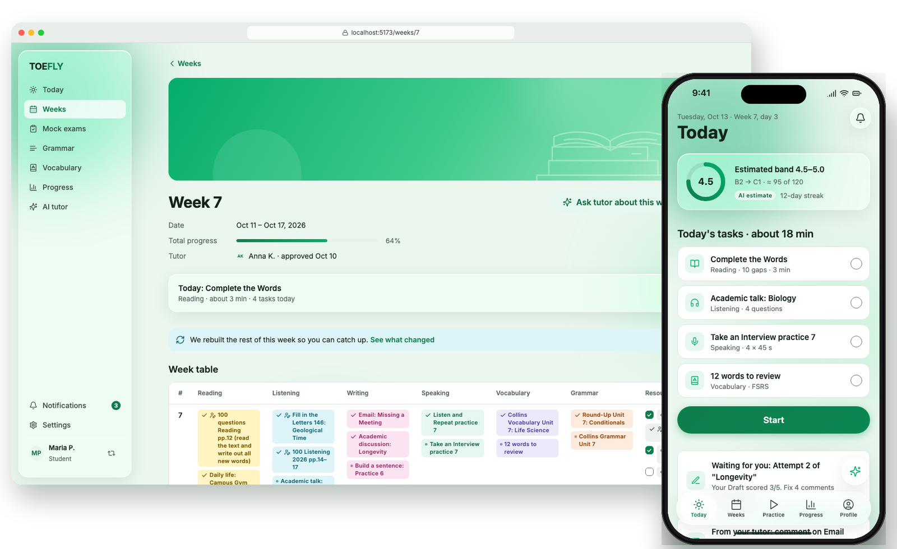
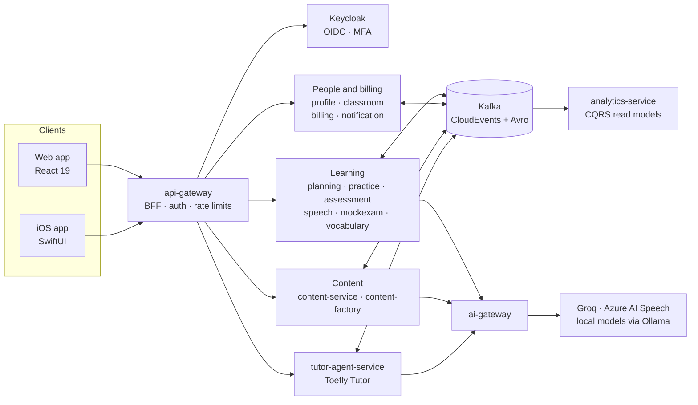

<p align="center">
  <picture>
    <source media="(prefers-color-scheme: dark)" srcset=".github/assets/logo-dark.svg">
    
  </picture>
</p>

<p align="center"><b>Prepare for the new TOEFL iBT the way you would with a personal tutor.</b><br>
Weekly plans built from your mistakes, feedback after every task, real adaptive mock exams. Web and iOS.</p>

<p align="center">
  
  
  
  
</p>

<p align="center">
  <picture>
    <source media="(prefers-color-scheme: dark)" srcset=".github/assets/hero-dark.png">
    
  </picture>
</p>

---

## What TOEFLY is

TOEFLY is a preparation platform for the TOEFL iBT in its format from January 21, 2026. It works like studying with a good tutor: every week you get a set of tasks across Reading, Listening, Writing, Speaking, grammar and vocabulary. After each task you get a review. At the end of the week you get a weekly review and a new week built from your mistakes.

The tutor role is played by **Toefly Tutor**, an AI agent that plans weeks, explains mistakes and answers questions in context. A human tutor can connect their students, approve the weekly plans the agent drafts and comment on their work.

## Features

**For students**

- **Diagnostic and plan.** A 25-minute diagnostic sets your starting band. The plan runs week by week up to your exam date.
- **Weeks, like a tutor's page.** Each week has a cover, the dates, total progress, a colour-coded task table and six section cards.
- **All 2026 task types.** There are 16 task types from Complete the Words to Take an Interview, in exam-like players with real timers.
- **Feedback you can act on.**
  - Closed tasks explain every distractor.
  - Writing gets inline comments with Attempt 2 and Attempt 3.
  - Speaking gets word-level pronunciation scores.
- **Adaptive mock exams.** Scores are reported on the 1–6 band scale, as CEFR and on the comparable 0–120 scale.
- **Vocabulary with spaced repetition.** Reviews are scheduled with FSRS. Grammar units follow New Round-Up and Collins.
- **Honest estimates.** Every predicted score is marked as an estimate and needs enough data first.

**For tutors**

- A dashboard of students with progress, band and who is falling behind.
- Approve or edit AI-drafted weeks within 48 hours, by day or as a table.
- Add your own materials as page ranges from PDFs, or turn them into interactive exercises.
- Comment on essays and recordings next to the AI feedback.

## Architecture

TOEFLY is an event-driven system of 17 services with explicit boundaries, one database per service and contracts first.



- **Events.** Services publish domain events through a transactional outbox (Debezium). Practice attempts are event-sourced, and consumers are idempotent.
- **AI behind one gateway.** Every LLM, speech-to-text and text-to-speech call goes through `ai-gateway`, which handles routing, free-tier quotas, fallbacks and evals. Personal data is masked locally before any external call.
- **Scoring.** Ability is estimated with the Rasch model (IRT). Writing and Speaking are graded against the ETS rubrics with double-pass checks.

## Tech stack

| Area | Technologies |
|---|---|
| Backend | Java 21, Spring Boot 4.1, Spring AI 2.0, Spring Cloud Gateway, Maven multi-module |
| Data and messaging | PostgreSQL 17 with pgvector, Kafka (KRaft), CloudEvents, Avro with Apicurio Registry, Valkey |
| Identity | Keycloak (OIDC, MFA), BFF session for the web |
| AI and speech | GroqCloud (LLMs, Whisper), Azure AI Speech (pronunciation, TTS), Ollama (PII masking, guardrails, embeddings) |
| Web | React 19, TypeScript, Vite, TanStack Router and Query, Tailwind CSS v4, shadcn/ui |
| iOS | SwiftUI on iOS 26 with Liquid Glass, Swift Testing |
| Landing | Astro on Cloudflare Pages |
| Platform | k3s, Helm, Argo CD, Linkerd, Sealed Secrets, GitHub Actions, OpenTelemetry, Grafana |
| Quality | JUnit 5, Testcontainers, ArchUnit, Spring Cloud Contract, Vitest, Playwright, Gatling, AI evals |

## Status

TOEFLY is in early development. The repository currently holds the clickable prototype of the key web and iOS screens; the services and clients are being built next.

## Try the prototype

You need Node.js 20 or newer.

```bash
git clone https://github.com/graffegiraffe/TOEFLY.git
cd TOEFLY
npx serve design/prototype
```

Open the printed URL. The toolbar switches between the web and iPhone frames, light and dark themes, and reduced transparency. The **Screens** menu lists every screen.

## Run locally

You need JDK 21, Docker (Docker Desktop or OrbStack, 12 GB for the VM) and Node.js 20 or newer for the hooks.

```bash
cp infra/compose/.env.example infra/compose/.env
docker compose -f infra/compose/compose.yaml up -d
./mvnw verify
```

The default Compose profile starts PostgreSQL 17 with pgvector, Kafka, Kafka Connect with Debezium, Apicurio Registry, Keycloak, Valkey, SeaweedFS and Mailpit. Add `--profile ai` for Ollama and `--profile obs` for the OpenTelemetry Collector and Grafana LGTM on port 3000.

A new service starts from the template:

```bash
tools/new-service.sh practice-service 8084
./mvnw -pl services/practice-service spring-boot:run -Dspring-boot.run.profiles=local
```

Install the Git hooks once with `lefthook install`.

## Repository structure

| Folder | Contents |
|---|---|
| `libs/` | `platform-bom`, `toefly-parent` and the shared libraries for events, web, security, observability, outbox and tests |
| `services/` | One Maven module per service, hexagonal packages |
| `clients/` | Web (React), iOS (SwiftUI) and landing (Astro) clients |
| `infra/compose/` | Local infrastructure in Docker Compose |
| `infra/k8s/`, `infra/helm/`, `infra/argocd/` | Cluster deployment |
| `infra/keycloak/` | Keycloak image and the `toefly` realm |
| `tools/` | Service archetype and `new-service.sh` |
| `design/prototype/` | Clickable prototype of the key screens |
| `.github/` | CI workflows, PR and issue templates |

## Educational content

Tasks taken from published study materials always name their source. The texts of those tasks are never stored in this repository. Rights holders can ask for material to be removed by opening an issue.

## License

The code is released under the [MIT License](LICENSE).

TOEFL and TOEFL iBT are registered trademarks of ETS. TOEFLY is not affiliated with or endorsed by ETS.
